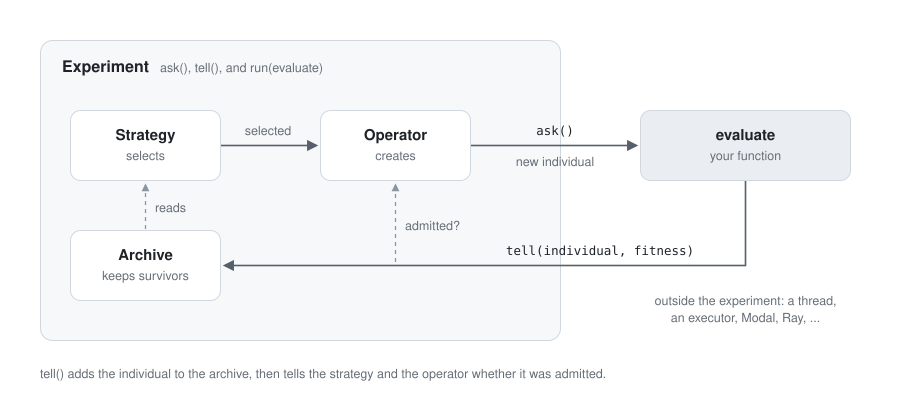
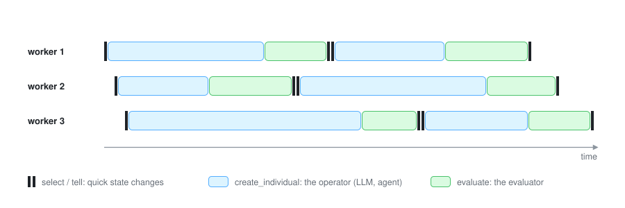

# Ask/tell: a light Experiment

**Status: implemented** in `evokit/experiment.py`.

## The design in one block

```python
experiment = Experiment(
    archive,            # which individuals survive
    strategy,           # which individuals to build on
    operator=None,      # how new individuals are made (None: you make them)
    seeds=(),           # starting genomes: the first asks return these
    store=None,         # where the record is kept (default: in memory)
)

best = experiment.run(
    evaluate,           # your function: (individual, workdir) -> number | dict | Fitness (sync or async)
    workers=8,          # how many individuals are in flight at once
    executor=None,      # where a sync evaluate runs: any concurrent.futures.Executor (default: threads)
    max_evaluations=5000, max_cost=20.0, max_time="2h",
)
```

| Method | What it does |
| --- | --- |
| `ask()` | The next seed, else the next queued child, else: the strategy selects and the operator creates. Returns one individual without fitness, or `None` if the operator discarded what it made. Once every seed is asked, selection waits until this process's seeds are told, so no worker selects from an archive that is still empty. |
| `select()` | Only the selection, for when there is no operator and you (or an outside agent) make the individual. |
| `tell(individual, fitness)` | Saves it to the store, offers it to the archive, then tells the strategy and the operator whether it was admitted. Returns admitted. |
| `run(evaluate, ...)` | Loops ask, evaluate, tell on `workers` workers until a limit is reached. Returns the best individual. |

`experiment.archive` is there to look at the population. That is the whole class.

### The component signatures

```python
class Strategy:
    async def select_individuals(self, archive, n) -> list[tuple[Individual, ...]]: ...

class Operator:
    async def create_individuals(self, selected, archive) -> list[Individual]: ...

def evaluate(individual, workdir) -> number | dict | Fitness: ...
```

- **Operators see the archive, read-only.** Most ignore it. It is for checks that depend on
  the *new* individual, which the strategy cannot make in advance: an OMNI-EPIC-style
  interestingness check, novelty or duplicate checks against similar members, "don't
  repeat ideas that already failed".
- **Operators return a list.** One call may make several children (one LLM call proposing
  four ideas, crossover making two); the experiment queues the extras, so `ask()` still
  returns one. `[]` means nothing worth evaluating. To discard with a reason and a cost,
  raise `OperatorError(reason, usage)`. Either way a `discarded` event is recorded and the
  cost is counted.
- **`evaluate` gets the individual and a folder.** The individual gives the id and the
  parents (to warm-start from a parent's outputs); `workdir` is
  `store.artifacts(individual.id)`, a folder for outputs too large for `feedback`
  (policies, logs, solutions). Operators and later evaluations read a parent's with
  `store.artifacts(parent.id)`. An empty folder is removed after evaluation.
- **`Fitness.usage` is what evaluating cost.** It is added to what creating cost
  (`info["usage"]`) and counts toward `max_cost`. A dict result may use the key `"usage"`.
- **An operator that cannot run twice at once** (a persistent agent session) raises
  `UsageError` when called concurrently; run it with `workers=1`.



## Why this shape

### Today's loop

```python
selected   = await strategy.select_individuals(experiment.archive, 1)
individual = await operator.create_individual(selected[0])
individual = experiment.evaluate_individual(individual)
admitted   = experiment.add_individual(individual)
strategy.tell([individual], [admitted]); operator.tell([individual], [admitted])
```

- **The archive is in the wrong place.** Survival is part of the algorithm, but today's
  `Experiment` holds it next to the evaluator, so the loop reaches into it.
- **Evaluation is tangled with record keeping.** `evaluate_individual` runs the evaluator,
  saves to the store, charges a `Budget`, and returns a new `Individual`.
- **There are too many levels.** `Experiment`, `Engine`, `Evaluator`, `Budget`, and the
  caller all share one loop.
- **Async is bolted on.** `Engine.step` creates a batch and waits for the slowest before
  admitting any.

### What other libraries do

| Library | Shape | Parallelism |
| --- | --- | --- |
| [Optuna](https://optuna.readthedocs.io/en/stable/tutorial/20_recipes/009_ask_and_tell.html) | `create_study(sampler, pruner, storage)`; `study.ask()`, `study.tell(trial, value)`; `study.optimize(objective, n_trials, n_jobs, timeout)` | [`n_jobs` threads; several processes on one storage; several machines on a database](https://optuna.readthedocs.io/en/stable/tutorial/10_key_features/004_distributed.html) |
| [Nevergrad](https://facebookresearch.github.io/nevergrad/optimization.html) | `optimizer.ask()`, `optimizer.tell(x, loss)`; `optimizer.minimize(fn, executor=...)` | Any `concurrent.futures.Executor`; steady state (`batch_mode=False`) |
| [DEAP](https://deap.readthedocs.io/en/master/tutorials/basic/part4.html) | A toolbox of operators | Replace `toolbox.map` with `pool.map` or SCOOP's `futures.map` |
| [estool](https://github.com/hardmaru/estool), pycma | `solver.ask()`, `solver.tell(rewards)` | The caller evaluates however it likes (estool uses MPI) |
| [pyribs](https://docs.pyribs.org/en/stable/) | An archive and emitters behind a scheduler with `ask()` / `tell()` | The caller evaluates |

Every one of them keeps evaluation outside the algorithm and gives it an `ask` / `tell`
interface. Optuna is the closest model for `Experiment`: the object holds the algorithm's
parts and the storage, the objective is passed to the run method rather than the
constructor, and parallelism comes from the run method's arguments and from sharing
storage.

### The decisions

- **`evaluate` is a function, not a class.** It takes the individual and its artifact
  folder and returns a number, a dict, or a `Fitness`; `Fitness.from_result` normalizes it.
  It can be sync or async. `files.ScriptEvaluator(project, command)` stays, as a callable
  object you pass in.
- **`evaluate` goes to `run()`, not the constructor** (as in Optuna). `ask()` and `tell()`
  never need it, so the experiment is only the algorithm plus the record.
- **Seeds are the first asks** (Optuna's `enqueue_trial`, Nevergrad's `suggest`). They are
  evaluated and told like every other individual, so there is no separate start step.
- **Limits are arguments to `run()`**, not a `Budget` object. They count the whole
  experiment (everything in the store), so a resumed run continues to the same totals.
  `max_cost` adds up creation cost (`info["usage"]`), evaluation cost (`Fitness.usage`),
  and the cost of discarded attempts. Draft evaluations count toward `max_evaluations`.
- **No `Engine`, `Search`, `Evaluator`, or `Budget`.** The archive, strategy, and operator
  are passed straight to `Experiment`.

### Should `ask()` take the archive?

No. The experiment owns the archive, so `ask()` takes no arguments; if callers passed the
archive in, they would own survival again and have to keep it consistent with what
`tell()` updates. Inside, `ask()` passes the archive to
`strategy.select_individuals(archive, n)`: the strategy reads it through `niches()` and
`members()` and never keeps it, which is what lets any strategy work with any archive.

## The loop

`run` is this:

```python
async def worker():
    while within_limits():
        individual = await self.ask()
        if individual is None:          # the operator discarded what it made
            continue
        workdir = self.store.artifacts(individual.id)
        fitness = Fitness.from_result(await call(evaluate, individual, workdir))
        self.tell(individual, fitness)

await asyncio.gather(*(worker() for _ in range(workers)))
```

`call` awaits an async `evaluate`, and runs a sync one in `executor`. An exception from
`evaluate` becomes `Fitness("failed")` with the traceback as feedback.

By hand, the same thing is a few lines, and nothing else is needed:

```python
individual = await experiment.ask()
fitness = await evaluate(individual, experiment.store.artifacts(individual.id))
experiment.tell(individual, fitness)
```

## Async and parallelism



With `workers=N`, each worker repeats ask, evaluate, tell on its own. When one finishes, it
is told straight away and the worker starts again; nobody waits for the slowest. This is
Nevergrad's steady state, and it is what agent operators need.

Where the work runs:

| Work | Runs | Set by |
| --- | --- | --- |
| `operator.create_individuals` (LLM calls, agent sessions) | async, on the event loop; agents are subprocesses | `workers` |
| a sync `evaluate` | in `executor`: threads by default, or a process pool, Dask (`client.get_executor()`), loky, MPI (`MPIPoolExecutor`) | `executor` |
| an async `evaluate` (Modal, Ray, an HTTP service) | wherever it sends the work | `workers` |
| several processes or machines | several `run()` calls on one shared store, as with Optuna's storage | `store` |

There is no pool or orchestrator class: `concurrent.futures.Executor` is the standard
interface and every parallel library already provides one.

What keeps this safe:

- **State changes only in `ask`'s selection and in `tell`, and both are quick.** Creation
  and evaluation are the slow steps, and they change no shared state.
- **Tells arrive in any order.** A worker may tell a child whose parent has left the
  archive; admission depends only on the child.
- **Nothing awaits while holding the lock.** `tell` is synchronous for that reason.

## Persistence

`tell` saves the individual and its fitness, and the archive, strategy, and operator
state, to the store. With a `DirectoryStore`, `ask` and `tell` load the latest state under
the store's lock first, so several processes (each CLI call, or several `run()`s) work on
one population. Queued children and how many seeds have been asked are saved too, so a
restarted run picks them up.

A `DirectoryStore` keeps artifacts in `artifacts/<id>/` next to `individuals/`; a
`MemoryStore` keeps them in a temporary folder that is removed when the process exits.

## Subclassing `Experiment`

Algorithms are made by choosing components, not by subclassing. Islands, for example, are
an archive (one grid per island, migration inside `add`) plus a strategy that takes islands
in turn; see `examples/circle_packing/algorithms/openevolve.py`. Subclass `Experiment` only
when the loop itself is different, as pyribs does with its schedulers:

- **Generational:** `run` asks for a whole generation, evaluates it, and tells it together,
  for strategies like CMA-ES that update once per generation.
- **Operator scheduling:** choosing which operator makes the next individual based on
  results (pyribs' `BanditScheduler`).

Hill climbing, one-shot LLM mutation, coding agents, AVO, and population search all use the
plain `Experiment`.

## Each algorithm

| Algorithm | `Experiment(...)` | `run(...)` |
| --- | --- | --- |
| Hill climbing, fixed mutations | `BestArchive(), Greedy(), Choice({...})` | `run(evaluate)` |
| One-shot LLM mutation | `BestArchive(), Greedy(), DiffOperator(model, project)` | `run(ScriptEvaluator(...), workers=8)` |
| Coding agent as operator | `BestArchive(), Greedy(), CodingAgentOperator(...)` | `run(ScriptEvaluator(...), workers=4)` |
| AVO | `BestArchive(ties="accept"), Greedy(), CodingAgentOperator(..., persistent_session=True)` | `run(ScriptEvaluator(...), workers=1)` |
| Population search | `PopulationArchive(50), Tournament(3), Mutation()` | `run(evaluate, workers=16, executor=ProcessPoolExecutor())` |
| AlphaEvolve / OpenEvolve | `IslandArchive(...), IslandSampler(...), Choice({fast: DiffOperator, strong: DiffOperator})` | `run(cascade, workers=8)` |
| Darwin Goedel Machine | `UnboundedArchive(), ProportionalSelection(), SelfModify(store)` | `run(staged_benchmark, workers=4)` |
| Outside agent as operator | `BestArchive(), Greedy()`, no operator | CLI: `select-individuals`, edit, `evaluate-directory` (evaluates and tells) |
| RLM as the whole algorithm | an archive only | tools: `evaluate_genome` evaluates and tells |

See [algorithms.md](algorithms.md) for autoresearch, AVO, the Darwin Goedel Machine, and
AlphaEvolve / OpenEvolve on circle packing, and how OMNI-EPIC maps.

## What changed in the code

| Before | After |
| --- | --- |
| `Evaluator`, `FunctionEvaluator` | a function `(individual, workdir)` passed to `run()`; `ScriptEvaluator` is a callable |
| `Budget` | `max_evaluations`, `max_cost`, `max_time` on `run()` |
| `Engine`, `ek.evolve`, `batch_size` | `experiment.run(evaluate, workers=...)` |
| `Experiment(evaluator, archive, seeds, budget, store)` | `Experiment(archive, strategy, operator, seeds, store)` |
| `evaluate_individual`, `add_individual` | `tell(individual, fitness)` |
| `select_individuals` on `Engine` | `experiment.select()` (and the `select-individuals` command) |
| `start()` | seeds are the first asks |
| `create_individual(selected) -> Individual` | `create_individuals(selected, archive) -> list[Individual]` |
| `StagnationSupervisor` | `CodingAgentOperator(redirect_after=5)` |
| `CodingAgentOperator(evaluator=...)` | `CodingAgentOperator(draft_evaluate=...)` |

`Archive`, `Strategy`, `Store`, `files/`, and the implementations otherwise stay as they were.
`tell` attaches the fitness to the individual before offering it to the archive, so
archives and strategies still read `individual.fitness`.

## Open questions

- **Should strategies see what is in flight?** With eight workers, `Greedy` hands the same
  best individual to all eight. That is fine for agents, whose edits differ anyway. Optuna's
  TPE has `constant_liar` for this; for us it would mean
  `select_individuals(archive, n, pending)`.
