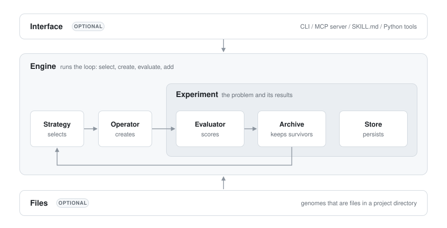

# EvoKit design

**Status: out of date.** This describes the API before ask/tell (`Engine`, `Budget`, the
`Evaluator` base class, `create_individual`). The current API is in [ask-tell.md](ask-tell.md).

EvoKit is a small library for evolutionary search where the variation step can be a
coding agent. Its central claim: a coding agent acting as the variation operator (inspect,
edit, test, repair, then hand back a new individual) beats one-shot LLM mutation at equal
cost. The v1 benchmark exists to test that claim.

## Principles

1. **The core is base classes, records, `Experiment` and `Engine`.** Each implementation is
   a subclass in the folder named after its base.
2. **Nothing in the core touches the filesystem.** `Individual.genome` is plain data: the
   individual's parameters.
3. **Storage is a base class, `Store`,** so persistence is just another subclass.
4. **Validity is the evaluator's call.** An invalid genome gets `status="failed"`; the
   archive only ranks. There are no gates.
5. **One job per component.** Each controls one decision and never reaches into another's.

## Layout

```text
evokit/
  records.py      Individual, Fitness
  evaluator.py    Evaluator        archive.py   Archive        strategy.py  Strategy
  operator.py     Operator         store.py     Store, encode_genome / decode_genome
  experiment.py   Experiment, Budget, Status
  engine.py       Engine, evolve
  errors.py  util.py

  evaluators/     function.py   FunctionEvaluator
  archives/       ranked.py     RankedArchive    best.py  BestArchive    population.py  PopulationArchive
  strategies/     greedy.py     Greedy
  operators/      choice.py     Choice           llm.py   LLMOperator, TextRewriteOperator
                  models.py     Model, AnthropicModel, OpenAIModel, FunctionModel
                  supervisor.py StagnationSupervisor           prompts.py  describe_individual
  stores/         memory.py     MemoryStore      directory.py  DirectoryStore

  files/          optional: evolving files in a project directory
                  tree.py Files    project.py Project    diff.py apply_diff, apply_rewrite
                  evaluator.py ScriptEvaluator    operators.py DiffOperator, FileRewriteOperator
                  coding_agent.py CodingAgentOperator    agents.py CodingAgent, ClaudeCode, CommandAgent
                  commands.py FileCommands
  interface/      optional: commands.py (@command registry, tools)  factory.py  cli.py  mcp_server.py  skill.py
```

`import evokit as ek` gives the core plus the implementation packages (`ek.archives`,
`ek.strategies`, ...). `evokit.files` and the CLI parts of `evokit.interface` are imported
explicitly.

## Records

```python
@dataclass(frozen=True)
class Fitness:
    status: Literal["ok", "failed", "error", "timeout"]
    objectives: dict[str, float] = {}
    constraints: dict[str, float | bool] = {}
    feedback: str | None = None

    Fitness.from_result(3.2)                           # {"score": 3.2}
    Fitness.from_result({"score": 1, "valid": True})   # numbers -> objectives, bools -> constraints

@dataclass(frozen=True)
class Individual:
    id: str
    genome: Any                      # the individual's parameters
    parents: tuple[str, ...] = ()    # ids it was created from; () = from scratch
    fitness: Fitness | None = None   # None until evaluated
    info: Mapping[str, Any] = {}     # operator, summary, usage, note, ...

    Individual.new(genome, parents=(), info=None)   # fresh id, no fitness
```

## The loop

```python
(selected,) = await strategy.select_individuals(experiment.archive, 1)  # () = create from scratch
individual = await operator.create_individual(selected)
individual = experiment.evaluate_individual(individual)   # evaluator -> fitness, recorded in history
admitted = experiment.add_individual(individual)          # archive keeps it or not
strategy.tell([individual], [admitted]); operator.tell([individual], [admitted])
```



## Base classes

### Evaluator: how good is this genome?

- **Controls:** the fitness of a genome, and whether it is valid (`status="failed"` if not).
- **Does not:** store anything, compare individuals, or decide survival.
- **Methods:** `async evaluate(genome) -> Fitness`.
- **Subclasses:** `FunctionEvaluator(fn, timeout=None)` wraps `fn(genome) -> number | dict |
  Fitness` (sync functions run in a thread; raising means failed, with the traceback as
  feedback). `Experiment` wraps a plain function in it automatically.
  `files.ScriptEvaluator(project, command)` is below.

### Archive: which individuals survive?

- **Controls:** the current population: which evaluated individuals are kept, which are
  dropped, and how they rank.
- **Does not:** keep history (the Store), pick individuals to work from (the Strategy), or score.
- **Methods:** `add(individual) -> bool` and `niches() -> Mapping[Hashable, list[Individual]]`
  (required); `members()` (every niche, flattened and ranked), `best()`, `state_dict()` /
  `load_state_dict()`.
- **Niches** expose structure the same way for every archive: unstructured archives have
  one niche (key `None`), a MAP-Elites grid one per cell, islands one each.
- **Subclasses:** `RankedArchive(objective="score", minimize=False)` admits only
  `status == "ok"` with a numeric objective. `BestArchive(ties="reject" | "accept")` keeps
  one best (`ties="accept"` is AVO's non-regressing commit rule); `PopulationArchive(size)`
  keeps the top `size`. Later: `GridArchive`.

### Strategy: which individuals to work from?

- **Controls:** which archive members each new individual is created from (none, one, or
  several), and when the search is finished.
- **Does not:** change the archive, create genomes, or score.
- **Methods:** `async select_individuals(archive, n) -> list[tuple[Individual, ...]]`
  (reads only `niches()` and `members()`, so every strategy works with every archive; async
  so a strategy can ask a model or a coding agent); `tell`, `done()`, state.
- **Subclasses:** `Greedy` (the best member, or from scratch when empty). Later: `Uniform`,
  `UniformNiche`, `Tournament(k)`, `Curiosity`, `AgentStrategy`.

### Operator: how is a new individual made?

- **Controls:** a new genome from the selected individuals (or from nothing), and what that
  cost, in `info["usage"] = {"cost_usd", "tokens", "draft_evals", "seconds"}`. On failure it
  raises `OperatorError(message, usage=...)`, and the usage is still charged.
- **Does not:** produce the real fitness or decide survival. It may score drafts with its
  own evaluator; drafts count toward the budget.
- **Methods:** `async create_individual(individuals) -> Individual` (no fitness); `tell`, state.
- **Subclasses:**
  - `Choice({"name": op}, weights=None, adapt=False)`: one operator per individual; with
    `adapt=True`, reweighted by admission rate.
  - `LLMOperator(model, instructions)`: subclasses implement `build_prompt(individuals)` and
    `parse_response(text, individuals) -> genome`. `TextRewriteOperator` for `str` genomes;
    `files.DiffOperator` and `files.FileRewriteOperator` for `Files`.
  - `files.CodingAgentOperator`.
- **Internals of particular operators:** `Model` (`AnthropicModel`, `OpenAIModel`,
  `FunctionModel`), `CodingAgent`, `StagnationSupervisor(patience, message)` (AVO's supervisor:
  after `patience` rejections in a row, the next prompt gets a redirect).

### Store: where is everything kept?

- **Controls:** every individual ever evaluated (including rejected ones), the event log,
  saved component state, content blobs, and the lock for concurrent use.
- **Does not:** evaluate, rank, select, or create.
- **Methods:** `save_individual`, `load_individual` (KeyError if missing), `individual_ids`,
  `append_event`, `events(limit)`, `save_state`, `load_state`, `put_blob`, `get_blob`,
  `lock()` (default: a reentrant thread lock).
- **Genomes in persistent stores:** JSON values are saved as they are. A genome type with
  `to_json(put_blob)` and `from_json(data, get_blob)` is saved as
  `{"$type": "module:Class", "data": ...}`; anything else is a usage error.
- **Subclasses:** `MemoryStore` (the default; keeps objects as they are) and
  `DirectoryStore(path)`:

```text
path/
  individuals/<id>.json   every individual ever evaluated
  blobs/ab/cdef...        content-addressed bytes (Files contents)
  state/<name>.json       archive, strategy, operator, budget, experiment, factory
  events.jsonl            evaluate, add, create_failed, ...
  lock                    fcntl lock shared by processes
```

## Experiment: the problem and its results

```python
Experiment(evaluator, archive, seeds=(), budget=Budget(), store=None, description=None)

experiment.start(allow_failed_seeds=False)   # evaluate and add the seeds, unless the store already has an experiment
experiment.evaluate_individual(individual) -> Individual   # evaluator, charge the budget, store it
experiment.evaluate_genome(genome, parents=None, note=None) -> Individual
experiment.add_individual(individual) -> bool              # archive.add, checkpoint, log
experiment.get_individual(id) / list_individuals() / best_individual() / list_events(limit) / status()
experiment.transaction(components, reload=None)            # lock, load state, save state
```

- **Controls:** wiring one evaluator, archive, store, and budget together; the seeds;
  enforcing and charging the budget; recording every evaluation.
- **Does not:** select or create individuals. It has no strategy, no operator, and no files.
- **Budget:** `Budget(evaluations, cost_usd, tokens, wall_time)`. Final and draft evaluations
  both count. The cost in `info["usage"]` is charged when the individual is evaluated, so
  the budget is overshot by at most one creation. Wall time counts from `start()`.
- **Sync API, async components:** operators, strategies, and evaluators are async; the
  experiment and engine drive them on a background event loop, so the same calls work from
  scripts, CLI processes, MCP handlers, REPLs, and Jupyter.
- **Concurrency:** long work (agent sessions, evaluations) runs outside the lock.
  `transaction` reloads the archive, budget, and named components from the store and
  saves them on exit, which lets several processes share one `DirectoryStore`.

## Engine: the loop

`Engine(experiment, strategy, operator=None, batch_size=1)` with `select_individuals(n)`,
`step()`, and `evolve(steps=None)`. It controls the loop order, concurrency
(`batch_size` individuals created at once), saving strategy and operator state, and
stopping when the budget is used up or `strategy.done()`. Without an operator, only
`select_individuals` works: the caller is the operator. `ek.evolve(experiment, strategy,
operator)` starts the experiment and runs the loop. Subclass and override `step` for a
different loop (islands, steady state).

## files/: evolving files

- `Files`: an immutable `{path: bytes}` value (`from_dict`, `from_directory`, `paths`, `read`,
  `text`, `with_files`, `write_to`, `render`, `to_json` / `from_json`).
- `Project(seed, genome=("**",), protected=DEFAULT_PROTECTED, ignore=DEFAULT_IGNORE,
  environment=None)` splits a seed directory into genome files and a read-only
  environment (everything else; `protected` defaults to `evaluate*`, `eval/**`, `.git/**`).
  The environment is copied once into `environment` (a temporary directory by default; pass
  a path to share it across processes). `seed_genome()`, `write(genome, directory)`, and
  `read(directory)`, which raises `EnvironmentModified` if environment files were edited.
- `ScriptEvaluator(project, command, timeout=None)`: writes the project to a fresh
  directory and runs the command there. The last JSON object on stdout (or `name: number`
  lines) is the result; a non-zero exit means failed, with stderr as feedback. An agent
  cannot game the score by editing the evaluator: it is part of the environment.
- `DiffOperator(model, project)` / `FileRewriteOperator(model, project)`: SEARCH/REPLACE
  diffs or full-file rewrites (`apply_diff`, `apply_rewrite`).
- `CodingAgentOperator(agent, project, evaluator=None, max_draft_evals=10,
  persistent_session=False, supervisor=None, instructions=None)`: writes the selected
  individual's project into a workspace, runs the agent there, and reads the genome back.
  With an evaluator, the agent can score drafts through `$EVOKIT_DRAFT_EVAL`. Agents:
  `ClaudeCode` (headless `claude -p`, `--resume` for sessions) and `CommandAgent(argv)`.
- `FileCommands(project)`: `checkout_individual`, `evaluate_directory`, `read_file`,
  `diff_individuals` (and `edit_individual` for Python tools).

## interface/: CLI, MCP, skill, tools

Methods on `Experiment`, `Engine`, and `FileCommands`, and on any component, are marked
with `@command`. One registry reads their signatures and docstrings and produces:

1. CLI subcommands (`click`), named after the method (`add_individual` becomes `add-individual`);
2. MCP tools (`evokit mcp`, requires the `mcp` extra);
3. a `SKILL.md` (`evokit skill export`), listing only the commands this experiment has;
4. `evokit.tools(*objects)`: plain synchronous callables for REPL drivers.

Parameters typed `Individual` take an id on the CLI and over MCP. Parameters typed
`Experiment` are filled in with the factory's experiment and never appear as arguments.
Component commands appear as `evokit <slot> <name>` and as tools named `<slot>_<name>`.

**Factories.** The CLI runs each command in a new process, so it rebuilds the objects from
a factory: `build(directory)` (or `build()`) returning an `Experiment` plus anything with
commands. `evokit init evo:build` records the reference and working directory in the
store's `factory` state, then calls `experiment.start()`; later commands rebuild from any
working directory. If the experiment uses the default `MemoryStore`, it gets a
`DirectoryStore` at `--dir`.

```text
evokit init MODULE:BUILD [--allow-failed-seeds]
evokit status | best-individual | list-individuals | get-individual ID | list-events
evokit select-individuals [--n N] | evolve [--steps N]           # with an Engine
evokit checkout-individual ID DIR | evaluate-directory DIR [--parent ID ...] [--note TEXT]
evokit read-file ID PATH | diff-individuals A B                   # with FileCommands
evokit add-individual ID
evokit mcp | skill export [claude|cursor|codex] [--stdout]
```

Output contract: compact JSON on stdout when it is not a TTY; errors as
`{"error", "code", "hint"}` on stderr; exit codes `0` ok, `1` internal error, `2` usage,
`3` budget exhausted, `4` done; no interactive prompts.

## Configurations

**Autoresearch.** `Project(".", genome=["train.py"])`, `ScriptEvaluator(project, "uv run
train.py", timeout="10m")`, `BestArchive(objective="val_bpb", minimize=True)`, and an
`Engine(experiment, Greedy())` with no operator: the coding agent is the operator, the
skill replaces `program.md`, admission replaces keep-or-reset, and the event log replaces
`results.tsv`.

**AVO.** An evaluator that fails incorrect kernels, `BestArchive(objective="tflops",
ties="accept")`, `Greedy()`, and `CodingAgentOperator(ClaudeCode(model="opus"), project,
evaluator=..., persistent_session=True, max_draft_evals=50,
supervisor=StagnationSupervisor(patience=5))`.

**An RLM as the whole algorithm.** `custom_tools=evokit.tools(experiment)`; the RLM calls
`list_individuals()`, `evaluate_genome()`, `add_individual()`, `status()` and writes
selection and variation itself.

## V1 scope and benchmark

Benchmark (`examples/circle_packing`): pack 26 circles in the unit square to maximize the
sum of radii. Arms share one experiment (`BestArchive` + `Greedy`, same seed): one-shot
diff, headless coding agent, AVO, and an outside agent as the operator. Equal dollar
budget with a wall-time cap; report best score over cost, evaluations (drafts included),
and wall time; at least 3 runs per arm. If neither agent arm beats one-shot at equal cost,
the central claim is wrong and the plan is revisited.

Next: `GridArchive` with `Uniform` / `UniformNiche`, `Tournament`, islands, Pareto, and
distributed execution.
