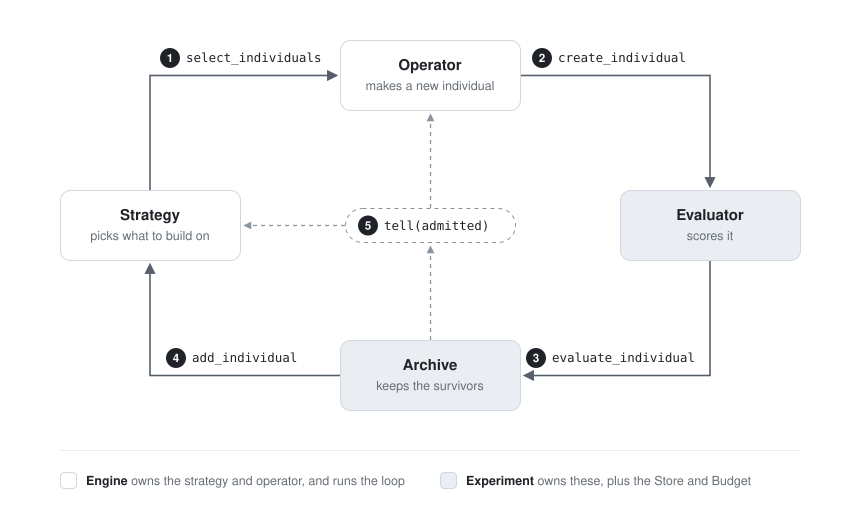

# EvoKit overview

**Status: out of date.** This describes the API before ask/tell (`Engine`, `Budget`, the
`Evaluator` base class, `create_individual`). The current API is in [ask-tell.md](ask-tell.md),
and the algorithms built on it are in [algorithms.md](algorithms.md).

What the pieces are, what each one is for, how the evolutionary algorithms EvoKit supports
are built from them, and where everything lives in the code. For the exact method
signatures see [design.md](design.md).

## The idea in one paragraph

Every evolutionary algorithm repeats the same loop: pick individuals to work from, make a
new one, score it, decide whether it survives. EvoKit gives each of those four decisions
its own component, plus one component to remember everything. An algorithm is then just a
choice of five components. "Hill climbing with Gaussian mutation", "AlphaEvolve-style LLM
diffs", and "AVO with a persistent coding agent" differ only in which components are
plugged in; the loop, the budget, the storage, and the CLI are the same for all of them.

## The loop



In code, one step is:

```python
selected   = await strategy.select_individuals(experiment.archive, 1)   # () = from scratch
individual = await operator.create_individual(selected[0])             # no fitness yet
individual = experiment.evaluate_individual(individual)                # evaluator; recorded; budget charged
admitted   = experiment.add_individual(individual)                     # archive keeps it or not
strategy.tell([individual], [admitted]); operator.tell([individual], [admitted])
```

## The components

There are five base classes. Each answers one question and is forbidden from answering
the others.

| Component | Question it answers | Never does | Shipped implementations |
| --- | --- | --- | --- |
| `Evaluator` | How good is this genome, and is it valid? | store, rank, decide survival | `FunctionEvaluator`, `files.ScriptEvaluator` |
| `Archive` | Which individuals survive, and how do they rank? | keep history, pick parents, score | `BestArchive`, `PopulationArchive` (both `RankedArchive`) |
| `Strategy` | Which individuals should the next one be made from? When is the search done? | change the archive, create, score | `Greedy` |
| `Operator` | How is a new individual made from those? | produce the real fitness, decide survival | `Choice`, `TextRewriteOperator`, `files.DiffOperator`, `files.FileRewriteOperator`, `files.CodingAgentOperator` |
| `Store` | Where is everything kept? | any evolutionary logic | `MemoryStore`, `DirectoryStore` |

Two classes wire them together, and two records are what flows between them:

| Piece | What it is for |
| --- | --- |
| `Experiment` | The problem and its results: one evaluator, archive, store, and budget, plus the seeds. It evaluates and records individuals and offers them to the archive. It knows nothing about strategies, operators, or files. |
| `Engine` | The loop: a strategy and (optionally) an operator, run over an experiment. Without an operator, whoever calls it (a coding agent, a person, a script) is the operator. |
| `Individual` | `id`, `genome` (any data: a list of floats, a string, a set of files), `parents` (ids), `fitness`, and `info` (operator name, cost, summary). Immutable. |
| `Fitness` | `status` (`ok`, `failed`, `error`, `timeout`), `objectives` (numbers), `constraints` (numbers or bools), `feedback` (text for the next operator to read). |

### Why the separation holds

Each boundary is enforced by what a component can see, not by convention:

- **The operator never sees the real fitness of what it makes.** It returns an individual
  with no fitness, and only `Experiment` calls the evaluator. An operator may score drafts
  with its own evaluator (the coding agent does), but those drafts are charged to the
  budget and never reach the archive.
- **The archive never decides validity.** The evaluator says `status="failed"` for an
  invalid genome; the archive just admits `ok` individuals it ranks well. So there is one
  place to look for "why was this rejected".
- **The strategy reads the archive only through `niches()` and `members()`.** So any
  strategy works with any archive: one best, a top-k population, or (later) a MAP-Elites
  grid.
- **Nothing but the store touches persistence.** Components expose `state_dict()` /
  `load_state_dict()`; the experiment saves and loads them. Swapping `MemoryStore` for
  `DirectoryStore` changes nothing else.
- **Feedback only flows through `tell`.** Strategy and operator learn what was admitted
  after each step, which is all an adaptive component needs (`Choice` reweights its
  operators; the coding agent redirects itself after a run of rejections).

The payoff is the table in [the algorithms section](#algorithms-as-configurations): every
algorithm below is a different row of the same five columns.

## Layers

```text
   optional    +-----------------------------------------------------------------+
               |  interface/   CLI (click)  |  MCP server  |  SKILL.md  |  tools  |
               +-----------------------------------------------------------------+
                                 |  calls @command methods on
                                 v
   core        +-----------------------------------------------------------------+
               |  Engine  ( Strategy, Operator )                                 |
               |    Experiment  ( Evaluator, Archive, Store, Budget )            |
               |  records: Individual, Fitness        errors, util               |
               +-----------------------------------------------------------------+
                                 ^  subclasses of the base classes
                                 |
   impl.       +-----------------------------------------------------------------+
               |  evaluators/  archives/  strategies/  operators/  stores/       |
               +-----------------------------------------------------------------+
                                 ^
                                 |
   optional    +-----------------------------------------------------------------+
               |  files/   genomes that are files in a project directory         |
               +-----------------------------------------------------------------+
```

- **Core** never touches the filesystem and never imports an implementation. Genomes are
  plain data.
- **Implementations** are subclasses, each in the folder named after its base class.
- **`files/`** is everything about evolving a directory of code: the `Files` genome, the
  project split into editable and protected files, a script evaluator, and the
  file-editing operators. Nothing else depends on it.
- **`interface/`** turns `@command`-marked methods into CLI commands, MCP tools, a skill
  file, and plain Python callables. Nothing in the loop depends on it.

## Algorithms as configurations

Each algorithm below is a choice of components. The diagrams show only what is specific
to that algorithm; the experiment's recording, budget, and storage are always the same.

| Algorithm | Evaluator | Archive | Strategy | Operator |
| --- | --- | --- | --- | --- |
| Hill climbing, fixed mutations | function | `BestArchive` | `Greedy` | your mutation, or `Choice` of several |
| One-shot LLM mutation | function or script | `BestArchive` | `Greedy` | `TextRewriteOperator` / `DiffOperator` |
| Coding agent as operator | script | `BestArchive` | `Greedy` | `CodingAgentOperator` |
| AVO | script that fails incorrect programs | `BestArchive(ties="accept")` | `Greedy` | `CodingAgentOperator(persistent_session=True, supervisor=...)` |
| Outside agent / autoresearch | script | `BestArchive` | `Greedy` | none: the agent driving the CLI |
| RLM as the whole algorithm | any | any | none: the RLM | none: the RLM |
| Population search | any | `PopulationArchive(size)` | yours (e.g. tournament) | any |

### 1. Hill climbing with fixed mutations

The classic baseline: mutate the best individual, keep the child if it is better. No
model, no cost per step; the budget is a number of evaluations.
See [`examples/fixed_mutation`](../examples/fixed_mutation/main.py).

```text
   +--------+  best   +---------------------------------+
   | Greedy | ------> | Choice(adapt=True)              |
   +--------+         |   GaussianMutation   (sigma)    |   picks one per child,
       ^              |   ResetMutation      (1 coord)  |   reweighted by admissions
       |              +---------------------------------+
       |                              | child genome
       |                              v
   +-------------+  admit if   +----------------------+
   | BestArchive | <---------- | FunctionEvaluator    |
   +-------------+   better    |   rastrigin(x)       |
                               +----------------------+
```

```python
experiment = ek.Experiment(rastrigin, BestArchive(), seeds=[x0], budget=ek.Budget(evaluations=5000))
ek.evolve(experiment, Greedy(), Choice({"gaussian": GaussianMutation(0.1), "reset": ResetMutation()}, adapt=True))
```

A fixed mutation is an `Operator` subclass a few lines long; EvoKit does not ship a
catalogue of them because which mutations make sense depends on the genome.

### 2. One-shot LLM mutation (the AlphaEvolve / OpenEvolve baseline)

One prompt, one reply, one child. The prompt shows the parent, its fitness, and the
evaluator's feedback; the reply is a full rewrite (strings) or SEARCH/REPLACE diffs (files).

```text
   +--------+  best   +---------------------+   prompt    +-------+
   | Greedy | ------> | DiffOperator        | ----------> | Model |  Anthropic / OpenAI /
   +--------+         |   build_prompt      | <---------- |       |  any function
       ^              |   parse_response    |    reply    +-------+
       |              +---------------------+
       |                     | child Files (+ tokens and $ in info["usage"])
       |                     v
   +-------------+  admit  +--------------------------------+
   | BestArchive | <------ | ScriptEvaluator                |
   +-------------+         |   writes project to a temp dir |
                           |   runs `python evaluate.py`    |
                           +--------------------------------+
```

```python
model = AnthropicModel("claude-sonnet-4-5", price=(3, 15))
ek.Engine(experiment, Greedy(), DiffOperator(model, project, instructions=TASK))
```

`LLMOperator` is the base for this family: subclasses implement `build_prompt` and
`parse_response`. An unusable reply raises `OperatorError`, and its cost is still charged.

### 3. A coding agent as the operator

Instead of one reply, a coding agent (Claude Code, Codex, Cursor's agent, any CLI) gets a
full copy of the project, edits it, runs it, and can score drafts before handing back the
result.

```text
   +--------+  best   +---------------------------------------------------+
   | Greedy | ------> | CodingAgentOperator                               |
   +--------+         |                                                   |
       ^              |   workspace/  <- project written here             |
       |              |      |                                            |
       |              |      v                                            |
       |              |   CodingAgent (ClaudeCode / CommandAgent)         |
       |              |      edit -> run -> $EVOKIT_DRAFT_EVAL -> edit    |
       |              |                        | draft score (counts      |
       |              |                        | toward the budget)       |
       |              |   read genome files back; reject environment edits|
       |              +---------------------------------------------------+
       |                     | child Files (+ $, tokens, draft_evals)
       |                     v
   +-------------+  admit  +-----------------+
   | BestArchive | <------ | ScriptEvaluator |   the real score, computed after the agent stops
   +-------------+         +-----------------+
```

```python
operator = CodingAgentOperator(ClaudeCode(model="sonnet"), project, evaluator=evaluator, max_draft_evals=10)
```

The evaluator script is part of the protected environment, so the agent cannot change how
it is scored; `Project.read` raises if it tried.

### 4. AVO

AVO is configuration 3 with three changes: one agent session that continues across
children, a commit rule that also accepts equal scores, and a supervisor that redirects the
agent after a run of rejections. The evaluator fails incorrect programs, so "not worse"
really means "correct and not slower".

```text
   +--------+  best   +----------------------------------------------+
   | Greedy | ------> | CodingAgentOperator(persistent_session=True) |
   +--------+         |   one conversation, resumed every step       |
       ^              |   + StagnationSupervisor(patience=5):        |
       |              |     after 5 rejections in a row, the next    |
       |              |     prompt says "try something different"    |
       |              +----------------------------------------------+
       |                     |                         ^
       |                     v                         | tell(admitted?)
   +---------------------------+  admit if  +-------------------------------+
   | BestArchive(ties="accept")| <--------- | ScriptEvaluator               |
   |  the lineage moves on any |  >= best   |  status="failed" if incorrect |
   |  non-regressing change    |            +-------------------------------+
   +---------------------------+
```

```python
experiment = ek.Experiment(evaluator, BestArchive(objective="tflops", ties="accept"), seeds=[project.seed_genome()])
operator = CodingAgentOperator(ClaudeCode(model="opus"), project, evaluator=evaluator,
                               persistent_session=True, max_draft_evals=50,
                               supervisor=StagnationSupervisor(patience=5))
ek.evolve(experiment, Greedy(), operator)
```

The lineage is the chain of admitted individuals in the event log, each the parent of the
next.

### 5. An outside agent as the operator (autoresearch)

The engine has no operator. The coding agent you are already talking to drives the loop
through the CLI (or MCP), following the generated skill file.

```text
   you / Claude Code / Cursor
        |
        |  evokit select-individuals          -> which individual to start from
        |  evokit checkout-individual ID DIR  -> a full project to edit
        |  ... edit, run, think ...
        |  evokit evaluate-directory DIR --parent ID   -> the real score
        |  evokit add-individual NEW_ID       -> admitted or not
        v
   +--------------------------------------------------------------+
   |  Engine(experiment, Greedy())        no operator             |
   |  Experiment: ScriptEvaluator, BestArchive, DirectoryStore    |
   +--------------------------------------------------------------+
```

```bash
evokit status --task . --dir runs/x        # creates the run from the task folder
evokit skill export claude                  # writes the instructions the agent follows
```

This is autoresearch's setup expressed in EvoKit: the skill replaces `program.md`,
admission replaces keep-or-reset, and the event log replaces `results.tsv`. Every CLI call
is a separate process; the `DirectoryStore` is what they share.

### 6. An RLM as the whole algorithm

A recursive language model (or any program that writes code) gets plain Python callables
and decides selection and variation itself. Only the evaluator and archive are fixed, so
scores stay honest.

```text
   +-----------------------------------------+
   |  RLM                                    |
   |    list_individuals()  best_individual()|
   |    evaluate_genome(genome, parents)     |  <- ek.tools(experiment, ...)
   |    add_individual(individual)           |
   |    status()                             |
   +-----------------------------------------+
                      |
                      v
   +-----------------------------------------+
   |  Experiment: Evaluator, Archive, Store  |   no Engine, no Strategy, no Operator
   +-----------------------------------------+
```

```python
rlm = RLM(custom_tools=ek.tools(experiment))
```

### 7. Population search

Replace the single best with a population, and selection becomes meaningful.

```text
   +-----------------+  some members  +----------+   child   +-----------+
   | your Strategy   | -------------> | Operator | --------> | Evaluator |
   | (tournament,    |                +----------+           +-----------+
   |  uniform, ...)  |                                             |
   +-----------------+                                             v
           ^                                         +-------------------------+
           +---------------- members() ------------- | PopulationArchive(size) |
                                                     |  keeps the top `size`   |
                                                     +-------------------------+
```

`PopulationArchive` exists; the only shipped strategy is `Greedy`, which always picks the
best member, so a real population method needs a strategy (tournament selection is a few
lines, like the fixed mutations). A MAP-Elites grid would be an `Archive` with one niche
per cell; strategies already read archives through `niches()`.

## What each part of the library is for

### Core: `evokit/`

| File | What it is for |
| --- | --- |
| `records.py` | `Individual` and `Fitness`, the data that flows between components. `Fitness.from_result` turns whatever an evaluation returns (a number, a dict, a bool) into a `Fitness`. `merge_usage` adds up cost dicts. |
| `evaluator.py` | The `Evaluator` base: `async evaluate(genome) -> Fitness`. |
| `archive.py` | The `Archive` base: `add`, `niches`, `members`, `best`, state. |
| `strategy.py` | The `Strategy` base: `async select_individuals(archive, n)`, `tell`, `done`, state. |
| `operator.py` | The `Operator` base: `async create_individual(individuals)`, `tell`, state. |
| `store.py` | The `Store` base (individuals, events, state, blobs, lock) and how genomes are saved: JSON as is, or `{"$type": ..., "data": ...}` for types with `to_json` / `from_json`. |
| `experiment.py` | `Experiment`, `Budget`, `Status`. Starting (evaluating the seeds), evaluating and recording, admission, queries, budget charging, and `transaction`, which locks the store and loads and saves component state so several processes can share it. |
| `engine.py` | `Engine` and `evolve`: select, create, evaluate, add, tell; `batch_size` children created at once; failures recorded as `create_failed` events. |
| `errors.py` | `UsageError` (bad input, with a hint), `BudgetExhausted`, `ExperimentDone`, `OperatorError` (carries the cost of the failed attempt), `EnvironmentModified`, `DiffError`. |
| `util.py` | Durations (`"10m"`), ids, glob matching, truncation, and the background event loop that lets sync code drive async components. |

### Implementations

| File | Class | What it is for |
| --- | --- | --- |
| `evaluators/function.py` | `FunctionEvaluator(fn, timeout)` | Score with a Python function (sync or async). Raising means `failed`, with the traceback as feedback. `Experiment` wraps plain functions in it automatically. |
| `archives/ranked.py` | `RankedArchive(objective, minimize)` | Shared base: rank by one objective, admit only `ok`. |
| `archives/best.py` | `BestArchive(ties)` | Keep one best. `ties="accept"` is AVO's commit rule. |
| `archives/population.py` | `PopulationArchive(size)` | Keep the top `size`. |
| `strategies/greedy.py` | `Greedy` | Always the best member (hill climbing, one lineage); from scratch when empty. |
| `operators/choice.py` | `Choice(operators, weights, adapt)` | Pick one operator per child; with `adapt`, favour the ones that get admitted. |
| `operators/llm.py` | `LLMOperator`, `TextRewriteOperator` | Base for one-prompt operators, and a full-rewrite operator for string genomes. |
| `operators/models.py` | `Model`, `AnthropicModel`, `OpenAIModel`, `FunctionModel` | The language models LLM operators call, with token and dollar accounting. No SDK dependencies. |
| `operators/prompts.py` | `describe_individual`, `join_notes` | Text pieces shared by prompting operators: an individual's id, fitness, and feedback. |
| `operators/supervisor.py` | `StagnationSupervisor(patience, message)` | AVO's redirect after a run of rejections; used by `CodingAgentOperator`. |
| `stores/memory.py` | `MemoryStore` | The default: everything in memory, genomes kept as objects. |
| `stores/directory.py` | `DirectoryStore(path)` | Everything in a directory (`individuals/`, `blobs/`, `state/`, `events.jsonl`, `lock`), shared safely by several processes. |

### `files/`: evolving a directory of code

| File | What it is for |
| --- | --- |
| `tree.py` | `Files`, an immutable `{path: bytes}` genome; contents stored as content-addressed blobs. `render()` for prompts, `digest` for identity. |
| `project.py` | `Project(seed, genome=[...])`: which files evolve (the genome) and which are a protected environment (the evaluator, data). Writes and reads projects; rejects edits to the environment. |
| `evaluator.py` | `ScriptEvaluator(project, command)`: write the project to a fresh directory, run a command, read metrics from stdout. Non-zero exit is `failed`. |
| `diff.py` | Apply SEARCH/REPLACE diffs and full-file rewrites from a model's reply. |
| `operators.py` | `DiffOperator`, `FileRewriteOperator`: one-shot LLM operators for `Files`. |
| `agents.py` | `CodingAgent` base, `ClaudeCode` (headless, resumable), `CommandAgent` (any CLI agent). |
| `coding_agent.py` | `CodingAgentOperator`: workspace, draft evaluations over a local socket, persistent sessions, supervision. |
| `commands.py` | `FileCommands`: `checkout-individual`, `evaluate-directory`; what an outside agent uses when it is the operator. |

### `interface/`: using EvoKit from a terminal or an agent

| File | What it is for |
| --- | --- |
| `commands.py` | The `@command` marker and registry, JSON encoding of results, and `ek.tools(...)` (plain callables for RLMs and scripts). |
| `setup.py` | Rebuilding a run in a new process from its task folder (`load_task`), recorded in the run at `run/task.json`; `open_history` opens any run for reading. |
| `history.py` | `HistoryCommands`: `log`, `show`, `diff`, `grep`, git-style reading of a run from its storage alone. |
| `cli.py` | The `evokit` command (click): one subcommand per `@command` method, JSON output, exit codes `0` ok, `1` internal, `2` usage, `3` budget exhausted, `4` done. |
| `mcp_server.py` | The same commands as MCP tools (`evokit mcp`). |
| `skill.py` | The evokit `SKILL.md`, generated from the command registry and shipped in `evokit/skills/`; `evokit skill export claude|cursor|codex` installs it. |

### Examples

| Path | What it shows |
| --- | --- |
| `examples/fixed_mutation/` | Hill climbing with two fixed mutations under `Choice`; no model. |
| `examples/circle_packing/` | The v1 benchmark: one experiment, four arms (`oneshot`, `agent`, `avo`, `external`) at equal dollar budget, plus `compare.py` to run repeats and report. |

## Open design questions

These are known rough edges, not yet decided:

- **`operators/` holds things that are not operators.** `Model` and its implementations
  are a separate base class; `describe_individual` is a rendering helper. Only `Choice` and
  the LLM operators are actually `Operator` subclasses. (`StagnationSupervisor` is gone: the
  redirect is now two `CodingAgentOperator` parameters, `redirect_after` and `redirect`.)
- **The core imports from `interface/`.** `experiment.py` and `engine.py` use the
  `@command` marker from `interface/commands.py`, so the core depends on the optional
  layer above it.
- **`files/agents.py` mixes a base class and its implementations** in one module, unlike
  the rest of the library.
- **Population search lacks a strategy.** Only `Greedy` ships.
