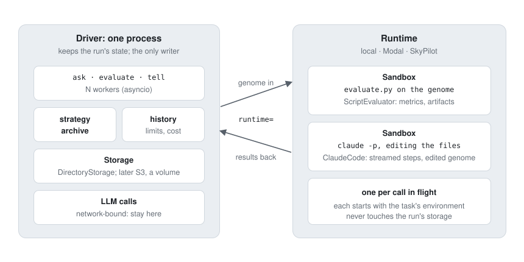

# Running work elsewhere: runtimes and sandboxes

**Status: proposal.** Nothing here is implemented. It extends the "Remote evaluation and
mutation" section of [caching-distribution-operators.md](caching-distribution-operators.md),
whose conclusion still holds for Python functions, and adds what that section left out: evokit's
own file-based components (`ScriptEvaluator`, `ClaudeCode`, `CommandAgent`).

## The question

Can a run spin up its operators and evaluations in their own containers (Modal, SkyPilot, ...),
many at once? And should that be one `Engine` class per platform (`LocalEngine`, `ModalEngine`,
`SkyPilotEngine`) that also replaces `Storage` and `history`?

Yes to the first; no to the second. Two questions are being mixed:

1. **Where the record of the run lives:** `Storage` (a local directory, memory; later S3 or a
   Modal Volume). It must have one writer, so that the history stays one consistent log.
2. **Where the slow work runs:** this machine, a Modal container, a SkyPilot VM.

An `Engine` per platform would answer both at once, so every pairing (a local driver with Modal
evaluations, a Modal driver with S3 storage, ...) would need its own class. Kept apart, any
storage works with any place to run. Evokit also had an `Engine` once (`Engine(experiment,
Greedy())`, in [design.md](design.md)); it was replaced by the plain `ask`, `evaluate` and
`tell` functions, which this proposal keeps.



## What runs where

| work | time | where it should run |
| --- | --- | --- |
| `strategy.select`, `archive.add`, `history`, the limits | microseconds | the driver: one process |
| an LLM call (`LLMOperator`, `DiffOperator`) | seconds; it waits on the network | the driver: 64 calls in flight need no extra machines |
| a Python `eval_fn` or `Mutate` function | any | wherever its author sends it (below) |
| `ScriptEvaluator`: `python evaluate.py` on the genome's files | seconds to hours, maybe a GPU | a sandbox |
| a coding agent: `claude -p` editing the files | minutes to hours | a sandbox |

Recipes already run N workers in one process (`asyncio.gather(*(worker() for _ in
range(workers)))`), and the slow steps already run as subprocesses or network calls, so the
driver stays one small process. What changes is where those subprocesses run.

## Python functions: no change

`eval_fn` and operators are async, so a function can already run anywhere. This is the pattern
from the earlier doc, and evokit needs nothing new for it:

```python
@app.function(gpu="A10G")                        # Modal
def score_remote(genome): ...

async def eval_fn(individual, workdir):
    return Evaluation(objectives=await score_remote.remote.aio(individual.genome))
```

An `executor=` argument on `ask` and `evaluate` was considered and rejected: it adds a concept
that does what the two lines above do, and it does not solve the file-based case, where files
have to move and commands have to run elsewhere.

## Commands on files: runtimes and sandboxes

The three components that run commands all do the same thing today, with `asyncio` subprocesses
in a temporary folder:

- `ScriptEvaluator.run`: write the environment and the genome, run the command, read stdout
  (metrics) and stderr (feedback), kill it on timeout;
- `ClaudeCode._exec`: run `claude -p` in a workspace, stream its stdout (steps, the live cost),
  kill it on timeout, then read the edited genome back;
- `CommandAgent.run`: the same for any CLI agent.

The proposal makes "where" a parameter of those three, with two small classes:

```python
class Runtime(ABC):
    """Where commands run: this machine, Modal, a SkyPilot cluster."""

    @abstractmethod
    def sandbox(self, environment: Path) -> AsyncContextManager["Sandbox"]:
        """A fresh, isolated folder holding a copy of `environment` (the task's fixed files)."""


class Sandbox(ABC):
    """One isolated folder on a runtime, and the commands run in it."""

    async def write(self, files: Files) -> None: ...                    # e.g. the genome
    async def read(self, paths: Sequence[str]) -> Files: ...            # e.g. the edited genome
    async def exec(self, argv: Sequence[str], env: Mapping[str, str], timeout: float | None) -> Process: ...


class Process(ABC):
    stdout: AsyncIterator[bytes]                                        # lines, as they come
    async def wait(self) -> int: ...                                    # the exit code
    async def stderr(self) -> str: ...
    async def kill(self) -> None: ...
```

The name follows OpenHands, whose `LocalRuntime`, `DockerRuntime` and `ModalRuntime` say the same
thing: where an agent's commands run. Not `Engine`, which in evokit meant the class that ran the
loop, and not `Environment`, which is already `Project.environment`, the task's fixed files.

The components take a runtime, local by default:

```python
eval_fn = ScriptEvaluator(project, "python evaluate.py", runtime=ModalRuntime(image, gpu="A10G"))
agent = ClaudeCode(model="opus", runtime=ModalRuntime(agent_image, secrets=["anthropic"]))
operator = CodingAgentOperator(agent, project)

# the recipe is unchanged; 16 workers means 16 sandboxes at once
await recipes.openevolve(project, eval_fn, operator, storage=storage, workers=16)
```

`ScriptEvaluator.evaluate_files` becomes:

```python
async with self.runtime.sandbox(self.project.environment) as sandbox:
    await sandbox.write(genome)
    proc = await sandbox.exec(self.argv, {**self.env, "EVOKIT_WORKDIR": "artifacts"}, self.timeout)
    stdout = b"".join([line async for line in proc.stdout])
    code, stderr = await proc.wait(), await proc.stderr()
    artifacts = await sandbox.read(["artifacts/**"])          # copied into the local workdir
return evaluation_from(code, stdout, stderr)                # parse_metrics, as now
```

and `ClaudeCode` writes the workspace into a sandbox, execs `claude -p ...` there, feeds the
streamed stdout lines to the same event loop it has now (steps, `_CostMeter`, the result), and
`CodingAgentOperator` reads the genome back with `sandbox.read(project.editable)`.

### The runtimes

- **`LocalRuntime()`**, the default: today's behavior, moved behind the interface. A sandbox is a
  temporary folder; `exec` is `asyncio.create_subprocess_exec` in its own process group, so the
  existing kill and reaping code moves here unchanged.
- **`ModalRuntime(image, gpu=None, secrets=(), timeout=...)`**: each sandbox is a
  [Modal Sandbox](https://modal.com/docs/guide/sandbox) created from `image`; `exec` is the
  sandbox's `exec`, whose stdout streams; `kill` terminates the sandbox. The task's environment
  is added to the image once per run (keyed by `project.environment_digest()`), so a sandbox
  starts with it in place and only the genome is uploaded each time.
- **`SkyPilotRuntime(cluster)`**: a cluster launched with SkyPilot (`sky launch`), reached over SSH;
  a sandbox is a fresh folder on one of its nodes, the environment is synced once with `rsync`,
  and `exec` is `ssh`. This suits long GPU runs on reserved machines more than many short jobs.

The exact Modal and SkyPilot calls (file upload, streaming exec, image caching) are to be checked
against their current documentation when `ModalRuntime` and `SkyPilotRuntime` are built.

### What stays on the driver

Everything that writes the run's record: `ask`, `evaluate`, `tell`, the history, the archive,
the limits, and the logs (`Offspring.logs`, artifacts), which come back as data and are written
by the driver as today. A sandbox never needs the run's storage, so `DirectoryStorage` on the
driver keeps working, and a remote runtime never holds the history.

## What needs a channel back to the driver

Two features talk to the driver while an agent works, over channels that only exist on one
machine today:

1. **AVO's commands and `$EVOKIT_DRAFT_EVAL`.** The agent's `evokit-commit` and `evokit-eval`
   scripts connect to a localhost socket (`AgentCommands`). In a remote sandbox they cannot reach
   it, and a laptop running the driver is usually not reachable from the internet either. The
   options:
   - a queue both sides can reach: the scripts put requests on a `modal.Queue` and wait for the
     reply on another, and the driver serves them (no inbound connection to the laptop);
   - an outbound tunnel from the driver (e.g. `cloudflared`), with the scripts calling it over
     HTTPS with a per-run token.
   Drafts have a third option: the sandbox already holds the environment, so a draft can run
   `evaluate.py` in the sandbox itself. Commits cannot: they change the archive.
2. **The read commands** (`evokit log/show/diff/grep`) read the run's directory through
   `EVOKIT_DIR`. A remote agent would need them served over the same channel, or a read-only
   copy of the history written into its sandbox when it starts (stale for a long session).

Until this is built, a remote `ClaudeCode` works with `CodingAgentOperator` (one child per
session, no back-channel), and AVO keeps a local runtime.

## Limits, cost, and failures

- **The limits are unchanged.** They are checked on the driver, against the history. The live
  cost estimate keeps working, because `ClaudeCode` still reads the stream, now from
  `Process.stdout`.
- **Machine cost is not counted.** `max_cost` is the LLM budget: what agents and models report
  (including an LLM judge inside an evaluation). A sandbox's machine time, GPU or not, is not
  recorded as cost and never stops a run; it is bounded by `workers` and the components'
  timeouts, and billed by the platform.
- **Stopping.** Cancelling a call cancels its sandbox (`Process.kill`, then the context manager
  tears the sandbox down), as killing the local process group does now.
- **Failures.** A sandbox that cannot start is a failed evaluation (with the runtime's error as
  feedback) or an `OperatorError`, so `max_failures` covers a broken image or quota. A sandbox
  lost mid-call (preemption) is the same; children already recorded as created and never
  evaluated are picked up again by `ask`, as after a crash.

## Not included

- Several drivers on one store, and a networked store: sections 2b and 2c of the earlier doc.
  They are not needed for this: one driver can keep hundreds of sandboxes busy.
- Islands across machines: a strategy and archive question, not an execution one.
- A task queue or scheduler: the recipe's `workers` decides how many sandboxes run at once.

## Order of work

1. `Runtime`, `Sandbox`, `Process`, and `LocalRuntime`; move `ScriptEvaluator`, `ClaudeCode` and
   `CommandAgent` onto them with no change in behavior (the test suite is the check).
2. `ModalRuntime`, as an optional dependency (`evokit[modal]`). Check it on circle packing with
   OpenEvolve: remote `ScriptEvaluator`, local LLM calls, then `CodingAgentOperator` with a remote
   `ClaudeCode`, comparing scores, wall time and cost with a local run.
3. The channel back (a queue or a tunnel), then AVO with a remote agent.
4. `SkyPilotRuntime`, if a GPU task needs it.

## Open questions

- A queue or a tunnel for the channel back (both need a service; the queue needs no inbound
  network to the driver)?
- Does `ClaudeCode` in a sandbox use an API key (a Modal secret) only, or is there a safe way to
  use a Claude Code login there?
